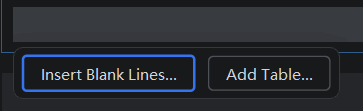
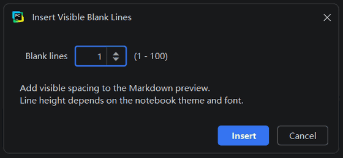
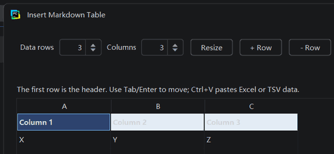

# Jupyter Notebook Markdown Tools

**English** | [简体中文](README.zh-CN.md)

Edit Markdown in local Jupyter notebooks in PyCharm. Paste an image to get a suggested save location and an automatically generated image reference. Use visual controls to set text colors, insert blank lines, and create tables with less hand-written Markdown and HTML.

**Version 0.1.1** 
## Features

- **Paste and manage images.** Paste an image from the clipboard or a single PNG, JPEG, or BMP file. The plugin suggests a save folder based on the notebook’s location in the project. Confirm or change the folder and display size in the dialog. The plugin saves a numbered PNG at the original resolution and automatically inserts a relative image reference into the Markdown cell.

  

- **Add text color** by selecting text in a Markdown cell and choosing **Text Color…** from the floating toolbar or context menu.

  

  

  

- **Insert visible blank lines** by tapping `Alt` twice on an empty Markdown line and choosing **Insert Blank Lines…**.

  

  

- **Build Markdown tables** by choosing **Add Table…** from the same menu. Edit the grid directly or paste data from Excel or TSV, then insert the generated table.

  

- **Recover images** from the plugin's recycle area. Automatic cleanup can recycle unreferenced, unchanged images created by the plugin after a save.

## Compatibility

Version 0.1.1 declares compatibility with PyCharm **2024.3 through 2026.3** (`243.21565.199 — 263.*`) for notebooks in local Windows projects. Enable **Jupyter**, **Notebook Files**, and **Markdown** in PyCharm. See the [Marketplace listing](https://plugins.jetbrains.com/plugin/36359-jupyter-notebook-markdown-tools) for version availability.

## Installation

1. In PyCharm, open **Settings → Plugins → Marketplace** and search for **Jupyter Notebook Markdown Tools**.
2. Select **Install** and follow PyCharm's prompts. Open a Markdown cell in a local `.ipynb` notebook to start using the plugin.

To install a ZIP built from this repository, open the gear menu in **Settings → Plugins**, choose **Install Plugin from Disk…**, and select the ZIP directly.

Find project options under **Settings → Tools → Jupyter Notebook Markdown Tools**. The **Tools → Jupyter Notebook Markdown Tools** menu also includes cleanup, recovery, and attachment export.

## Build and contribute

Use PowerShell 7 on Windows and a local PyCharm 2025.3 SDK for the example build below. Point `-IdeHome` to the directory that contains `product-info.json`.

```powershell
.\build.ps1 -IdeHome 'D:\PyCharm 2025.3'
```

The build runs the regression tests and creates an installable ZIP under `dist/`. See the [contribution guide](CONTRIBUTING.md) for the full setup, test commands, and source layout.

## License

The plugin code and project-authored documentation are available under the [MIT License](LICENSE). Third-party marks and materials retain their applicable terms. See [branding credits](docs/branding/README.md).

## Feedback

Open an issue with your PyCharm build number, Windows version, and the steps to reproduce the problem.
