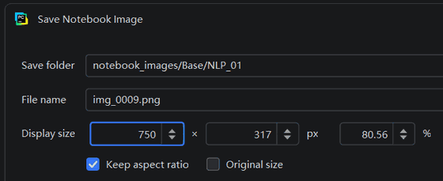
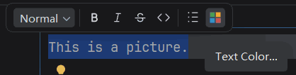
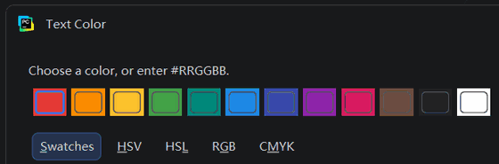
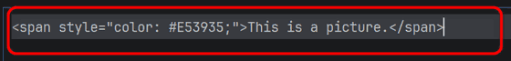

# Pycharm Jupyter Notebook Markdown Tools

**English** | [简体中文](README.zh-CN.md)

Paste images and format Markdown in local Jupyter notebooks in PyCharm.

**Version 0.1.0** · **Xu.J.W**

## Features

- **Paste images** from the clipboard or a single PNG, JPEG, or BMP file. Save them as numbered PNGs in your project, adjust their display size, and insert a relative link. The saved image keeps its original resolution.

  

- **Add text color** by selecting text in a Markdown cell and choosing **Text Color…** from the floating toolbar or context menu.

  

  

  

- **Insert visible blank lines** by tapping `Alt` twice on an empty Markdown line and choosing **Insert Blank Lines…**.

  

  

- **Build Markdown tables** by choosing **Add Table…** from the same menu. Edit the grid directly or paste data from Excel or TSV, then insert the generated table.

  

- **Recover images** from the plugin's recycle area. Automatic cleanup can recycle unreferenced, unchanged images created by the plugin after a save.

## Compatibility

PyCharm **2024.3** (build `243.21565.199` or later in that release) through **2025.3** on Windows, with a local notebook project. Enable **Jupyter**, **Notebook Files**, and **Markdown** in PyCharm.

## Installation

1. Open **Releases** in this repository and download `pycharm-jupyter-notebook-markdown-tools-0.1.0.zip` from **Assets**.
2. In PyCharm, go to **Settings → Plugins**, click the gear icon, and choose **Install Plugin from Disk…**.
3. Select the ZIP directly and restart PyCharm. Open a Markdown cell in a local `.ipynb` notebook to start using the plugin.

Find project options under **Settings → Tools → Jupyter Notebook Markdown Tools**. The **Tools → Jupyter Notebook Markdown Tools** menu also includes cleanup, recovery, and attachment export.

## Feedback

Open an issue with your PyCharm build number, Windows version, and the steps to reproduce the problem.
