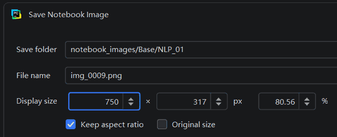
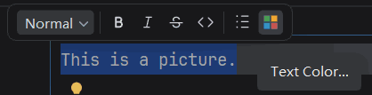
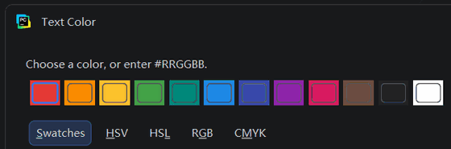
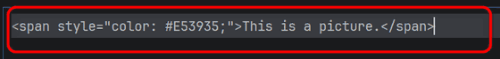
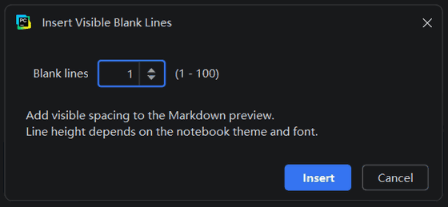
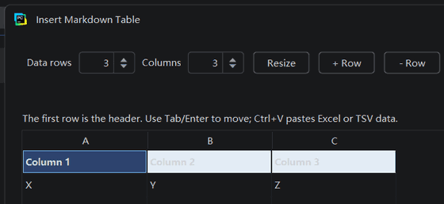

# Jupyter Notebook Markdown Tools

[English](README.md) | **简体中文**

为 PyCharm 中的本地 Jupyter Notebook 提供便捷的 Markdown 编辑功能。粘贴图片时自动推荐保存路径并生成图片引用代码，也可通过可视化操作设置文字颜色、插入空行和创建表格，减少手动编写 Markdown 和 HTML 语法的工作。

**版本 0.1.1** 

## 功能

- **粘贴并管理图片。** 支持粘贴剪贴板图片或单个 PNG、JPEG、BMP 文件。插件根据 Notebook 的项目路径推荐图片保存目录，你可以在弹窗中确认或调整路径和展示尺寸。图片会按顺序编号保存为 PNG，并自动在 Markdown 单元中插入使用相对路径的图片引用代码。保存的图片保留原始分辨率。

  

- **修改文字颜色。** 在 Markdown 单元选中文字，从浮动工具栏或右键菜单选择 **Text Color…**。

  

  

  

- **插入预览可见的空行。** 在空白 Markdown 行快速按下并松开 `Alt` 两次，再选择 **Insert Blank Lines…**。

  

  

- **制作 Markdown 表格。** 在同一个菜单中选择 **Add Table…**。可以直接编辑网格或粘贴 Excel、TSV 数据，再插入生成的表格。

  

- **恢复已回收的图片。** 自动清理可在保存后回收由插件创建、未被修改且无引用的图片，需要时可从插件回收区恢复。

## 兼容范围

0.1.1 面向 Windows 上的本地 Notebook 项目，声明兼容 PyCharm **2024.3 至 2026.3**（`243.21565.199 — 263.*`）。请在 PyCharm 中启用 **Jupyter**、**Notebook Files** 和 **Markdown**。各版本的上架状态见 [Marketplace 插件页面](https://plugins.jetbrains.com/plugin/36359-jupyter-notebook-markdown-tools)。

## 安装

1. 在 PyCharm 中打开 **Settings → Plugins → Marketplace**，搜索 **Jupyter Notebook Markdown Tools**。
2. 点击 **Install** 并按提示完成安装。打开本地 `.ipynb` 的 Markdown 单元即可使用。

安装从本仓库构建的 ZIP 时，在 **Settings → Plugins** 点击齿轮，选择 **Install Plugin from Disk…**，直接选中 ZIP。

项目设置位于 **Settings → Tools → Jupyter Notebook Markdown Tools**。手动清理、恢复和附件导出位于 **Tools → Jupyter Notebook Markdown Tools**。

## 构建与贡献

下面的源码构建示例使用 Windows、PowerShell 7 和本地 PyCharm 2025.3 SDK。将 `-IdeHome` 指向包含 `product-info.json` 的目录。

```powershell
.\build.ps1 -IdeHome 'D:\PyCharm 2025.3'
```

构建会运行回归测试，并在 `dist/` 下生成可安装的 ZIP。开发环境、测试命令和目录说明见[贡献指南](CONTRIBUTING.md)。

## 许可证

插件源码及项目自编文档采用 [MIT 许可证](LICENSE)。第三方标识与素材适用各自的条款，来源见[图标说明](docs/branding/README.md)。

## 反馈

欢迎在本仓库的 Issues 提交问题。请附上 PyCharm 构建号、Windows 版本和复现步骤。
